# Moonshot caption templates — visual index

Har template ka ek card: **pehla panel = official thumbnail**, baaki 3 panels = video ke frames jahan text dikh raha hai.
Source: https://makemoonshot.co/caption-templates (99 public templates, 13 families; 23 Oct 2026 ko liya). Moonshot ke editor mein ~158 aur styles hain jo public page par nahi hain.

Text patterns seekhne aur apply karne ke liye skill: `.claude/skills/moonshot-text-patterns/`.

## 01-Behind-the-Person — Behind the Person (17)

### Eclipse
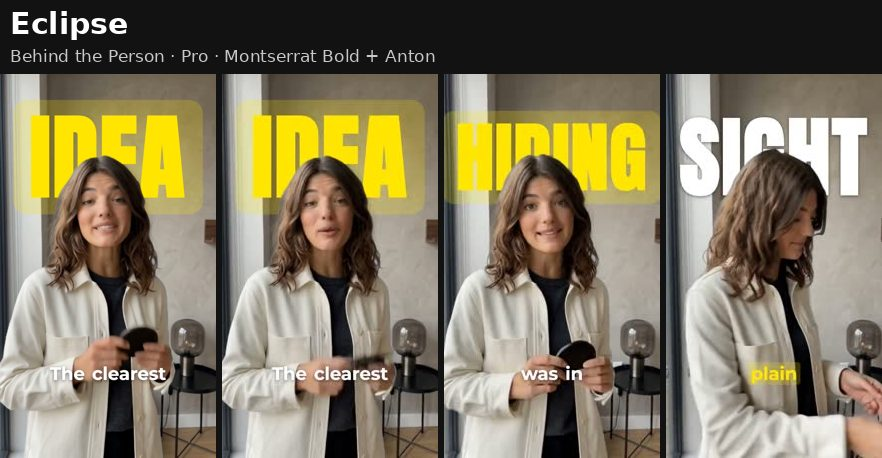

Key word locks behind you; subtitles ride your chest.  
Fonts: Montserrat Bold + Anton · Colours: `#FFFFFF #FFE500` · Words/line: Up to 4 · Motion: A colour block sits behind the spoken word · Plan: Pro · [page](https://makemoonshot.co/caption-templates/ca-split)

### Gatekeep
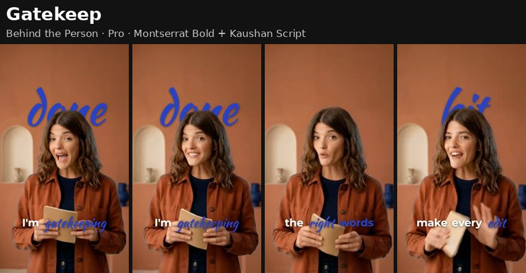

White subtitles up front, a royal-blue brush-script word behind you.  
Fonts: Montserrat Bold + Kaushan Script · Colours: `#FFFFFF #2742C4` · Words/line: Up to 4 · Motion: The spoken word flips to the highlight colour · Plan: Pro · [page](https://makemoonshot.co/caption-templates/ca-red)

### Retro Cut
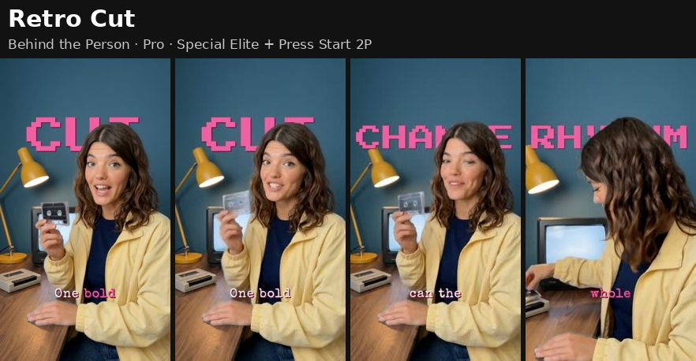

Typewriter subtitles in front, an 8-bit pixel word behind you.  
Fonts: Special Elite + Press Start 2P · Colours: `#F6EFE2 #F25FA0` · Words/line: Up to 4 · Motion: The spoken word flips to the highlight colour · Plan: Pro · [page](https://makemoonshot.co/caption-templates/ca-yellow)

### Sticker
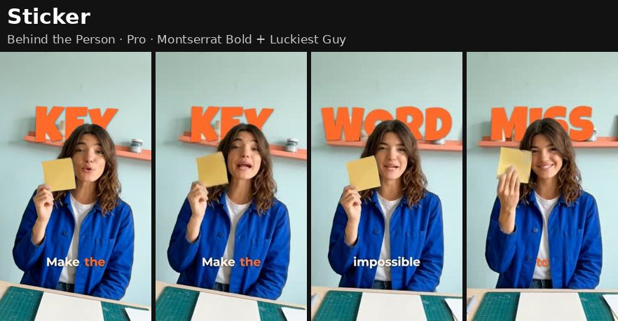

Cream subtitles in front, a chunky comic word behind you.  
Fonts: Montserrat Bold + Luckiest Guy · Colours: `#FFF1DC #FF6A2B` · Words/line: Up to 4 · Motion: The spoken word flips to the highlight colour · Plan: Pro · [page](https://makemoonshot.co/caption-templates/ca-editorial)

### Calligraph
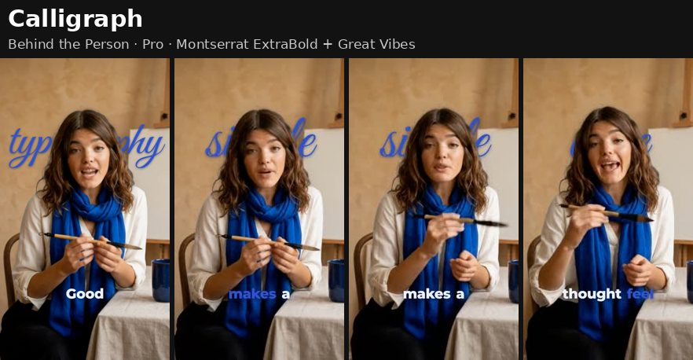

Soft-white subtitles, an ornate cobalt calligraphy word behind you.  
Fonts: Montserrat ExtraBold + Great Vibes · Colours: `#EAF0FF #2B53D4` · Words/line: Up to 4 · Motion: The spoken word flips to the highlight colour · Plan: Pro · [page](https://makemoonshot.co/caption-templates/ca-blue)

### Soundwave
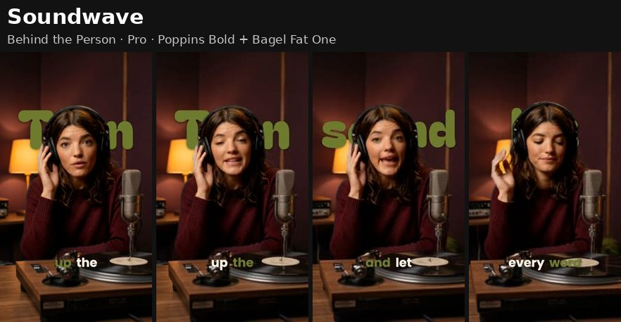

Warm-white subtitles in front, a fat rounded olive word behind you.  
Fonts: Poppins Bold + Bagel Fat One · Colours: `#FBF4E4 #6E7B2E` · Words/line: Up to 4 · Motion: The spoken word flips to the highlight colour · Plan: Pro · [page](https://makemoonshot.co/caption-templates/ca-mix)

### Signal
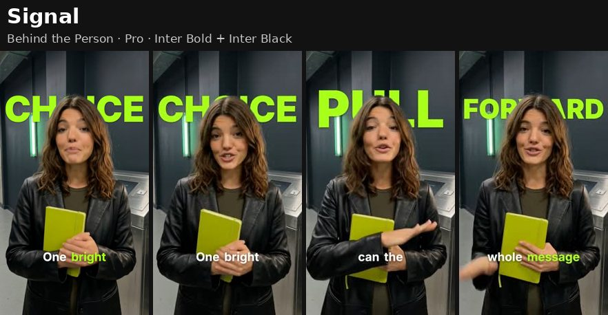

Neon-green impact word behind you, plain white subtitles in front.  
Fonts: Inter Bold + Inter Black · Colours: `#FFFFFF #A8FF1A` · Words/line: Up to 4 · Motion: The spoken word flips to the highlight colour · Plan: Pro · [page](https://makemoonshot.co/caption-templates/ca-neon)

### Kumar
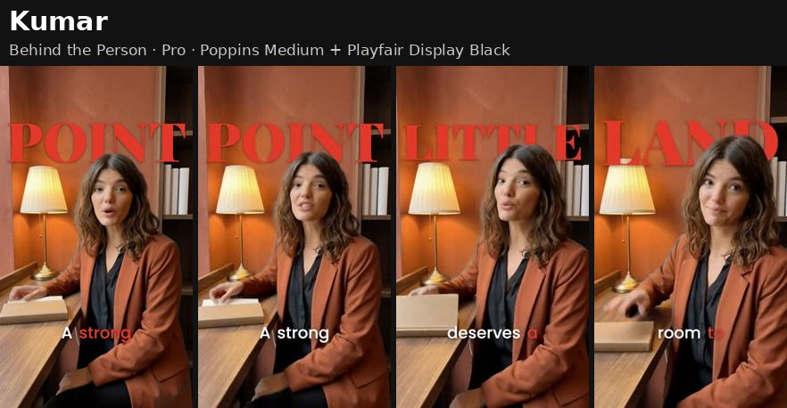

A big red editorial serif locks behind you; clean white subtitles in front.  
Fonts: Poppins Medium + Playfair Display Black · Colours: `#FFFFFF #E2382A` · Words/line: Up to 4 · Motion: The spoken word flips to the highlight colour · Plan: Pro · [page](https://makemoonshot.co/caption-templates/kumar)

### Deep Focus
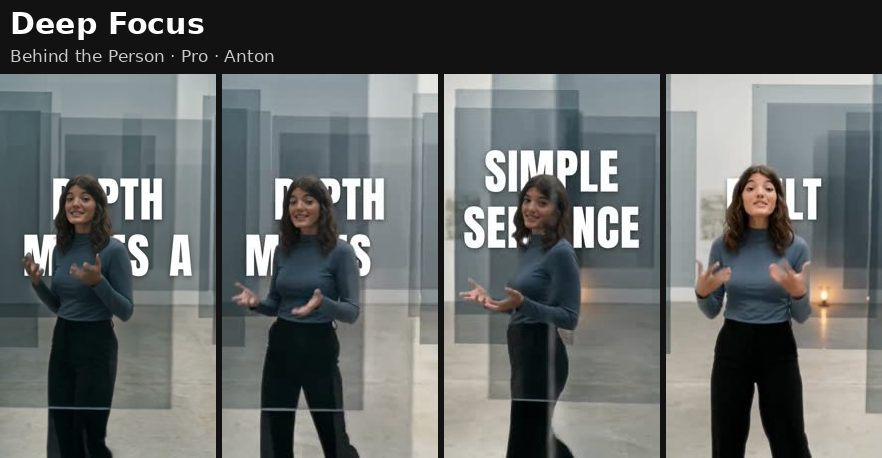

Text sits in real 3D space behind you.  
Fonts: Anton · Colours: `#FFFFFF` · Words/line: Up to 2 · Motion: Static emphasis · Plan: Pro · [page](https://makemoonshot.co/caption-templates/depth)

### Sprayline
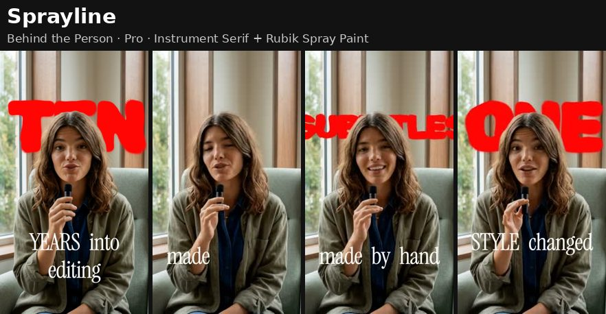

A red spray-painted phrase fills the frame behind clean serif captions.  
Fonts: Instrument Serif + Rubik Spray Paint · Colours: `#FFFFFF #FF0503` · Words/line: Up to 4 · Motion: The spoken word flips to the highlight colour · Plan: Pro · [page](https://makemoonshot.co/caption-templates/ca-sprayline)

### Golden Hour
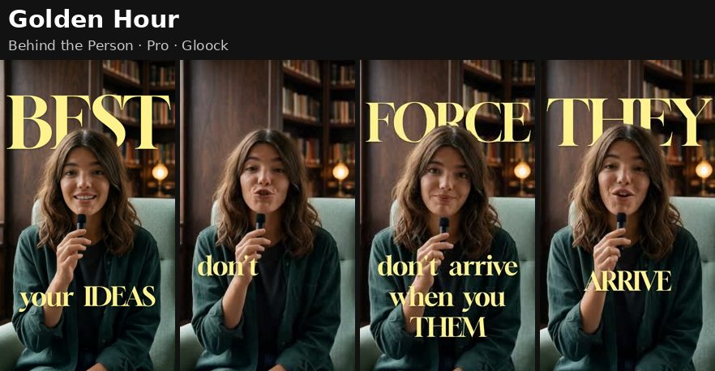

Large pale-yellow editorial words frame a smaller matching subtitle.  
Fonts: Gloock · Colours: `#FFF18F` · Words/line: Up to 3 · Motion: The spoken word flips to the highlight colour · Plan: Pro · [page](https://makemoonshot.co/caption-templates/ca-golden-hour)

### Ghostline
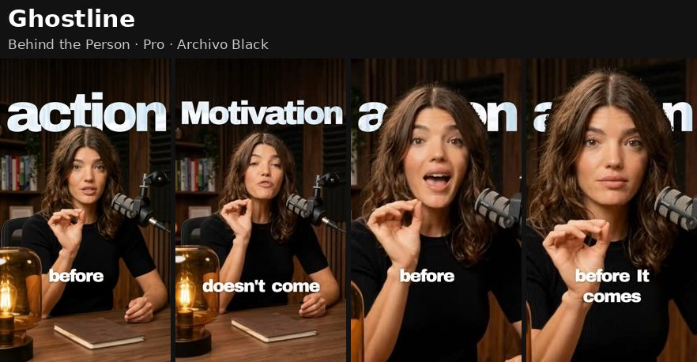

A dense white headline cuts through the subject above a compact subtitle.  
Fonts: Archivo Black · Colours: `#FFFFFF` · Words/line: Up to 3 · Motion: Static emphasis · Plan: Pro · [page](https://makemoonshot.co/caption-templates/ca-ghostline)

### Lime Swipe
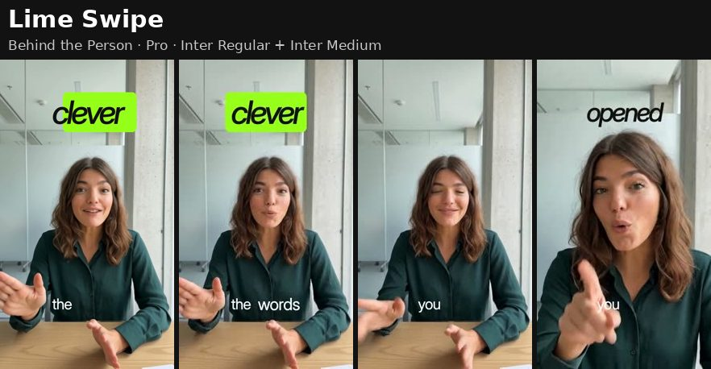

A black italic phrase slides across a sharp lime plate.  
Fonts: Inter Regular + Inter Medium · Colours: `#FFFFFF #121212` · Words/line: Up to 4 · Motion: A colour block sits behind the spoken word · Plan: Pro · [page](https://makemoonshot.co/caption-templates/ca-acid-slide)

### Monument
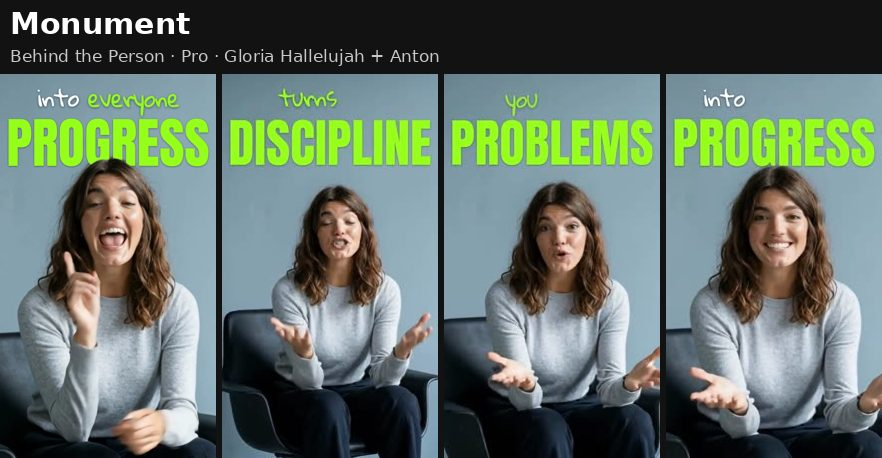

A lime uppercase hit drops above a loose handwritten subtitle.  
Fonts: Gloria Hallelujah + Anton · Colours: `#FFFFFF #96FF1A` · Words/line: Up to 4 · Motion: The spoken word flips to the highlight colour · Plan: Pro · [page](https://makemoonshot.co/caption-templates/ca-monument)

### Sunburst
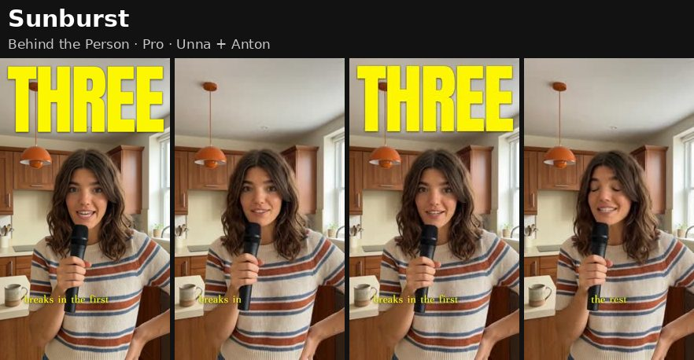

A bright yellow headline bounces behind a small serif subtitle.  
Fonts: Unna + Anton · Colours: `#FFF600` · Words/line: Up to 4 · Motion: The spoken word flips to the highlight colour · Plan: Pro · [page](https://makemoonshot.co/caption-templates/ca-sunburst)

### Crimson
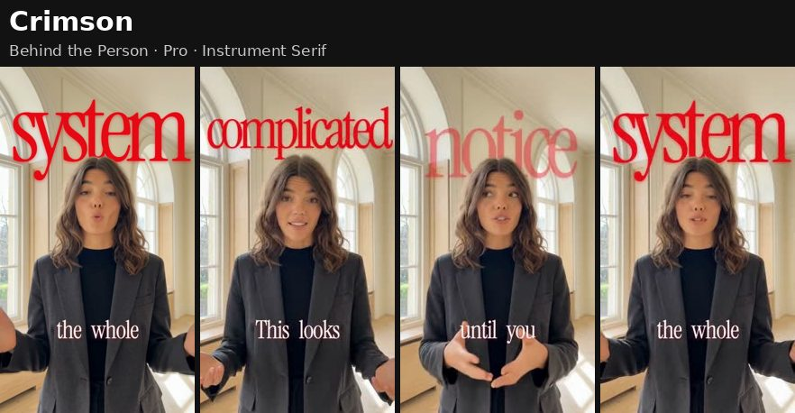

A red editorial phrase sits behind a soft-white matching subtitle.  
Fonts: Instrument Serif · Colours: `#EEEEEE #E50914` · Words/line: Up to 4 · Motion: The spoken word flips to the highlight colour · Plan: Pro · [page](https://makemoonshot.co/caption-templates/ca-crimson)

### Pastel Fisheye
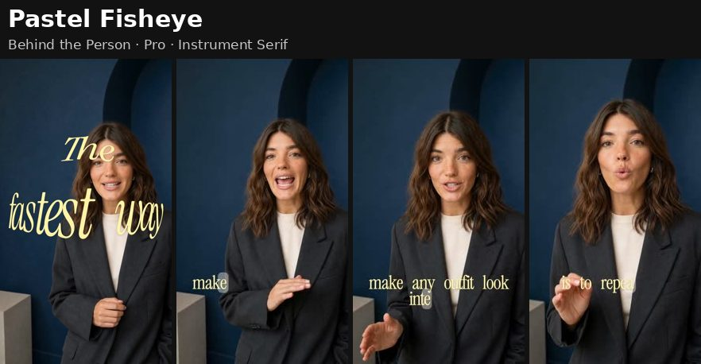

Pastel editorial type bends around you with a fisheye lens.  
Fonts: Instrument Serif · Colours: `#FFF3A8` · Words/line: Up to 4 · Motion: Static emphasis · Plan: Pro · [page](https://makemoonshot.co/caption-templates/pastel-lens)

## 02-AI-Edits — AI Edits (35)

### Blackboard
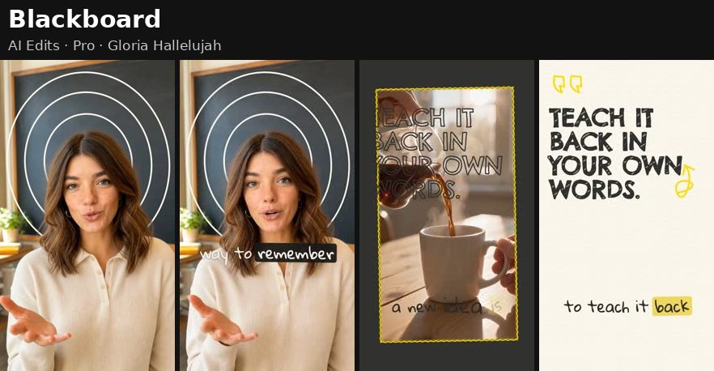

Handwritten caption chips, rear chalk words, and heavy outline hits.  
Fonts: Gloria Hallelujah · Colours: `#FFD400` · Words/line: Up to 4 · Motion: A colour block sits behind the spoken word · Plan: Pro · [page](https://makemoonshot.co/caption-templates/chalk)

### Marginalia
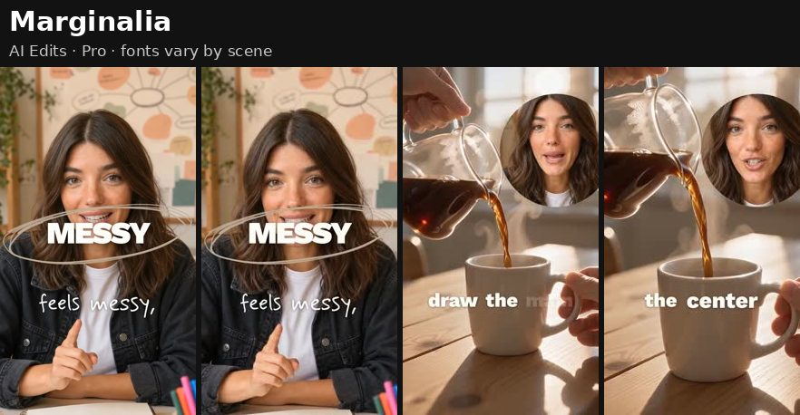

Handwritten captions, circled keywords, and a notebook layout for every section.  
Fonts: scene ke hisaab se · Colours: `#FFFDF8` · Words/line: Up to 6 · Motion: Static emphasis · Plan: Pro · [page](https://makemoonshot.co/caption-templates/sketch)

### Kraft
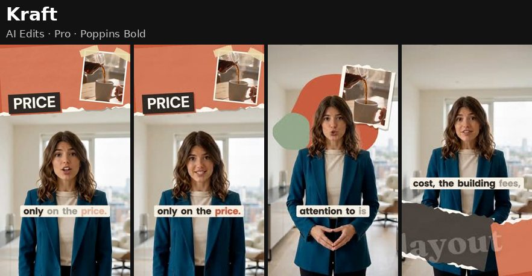

Warm paper collage: torn strips, tape labels, and a pill caption that fills as you speak.  
Fonts: Poppins Bold · Colours: `#2D2622 #C65A3A` · Words/line: Up to 4 · Motion: The spoken word sits in a box · Plan: Pro · [page](https://makemoonshot.co/caption-templates/paper)

### Matinee
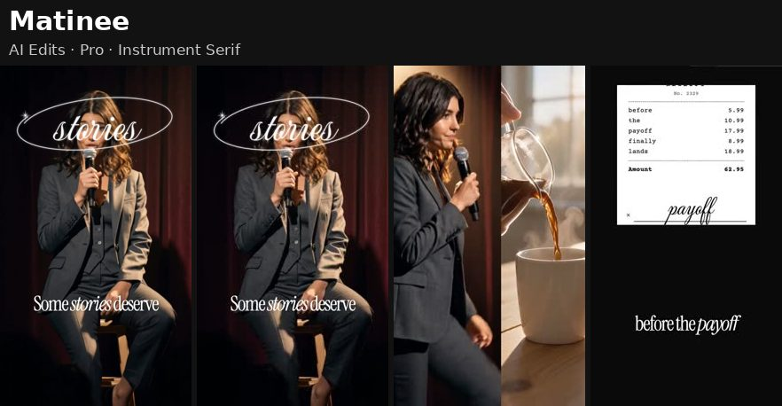

Cinematic serif captions, script film titles, and soft split screens.  
Fonts: Instrument Serif · Colours: `#FFFFFF` · Words/line: Up to 5 · Motion: Static emphasis · Plan: Pro · [page](https://makemoonshot.co/caption-templates/elevate)

### Refract
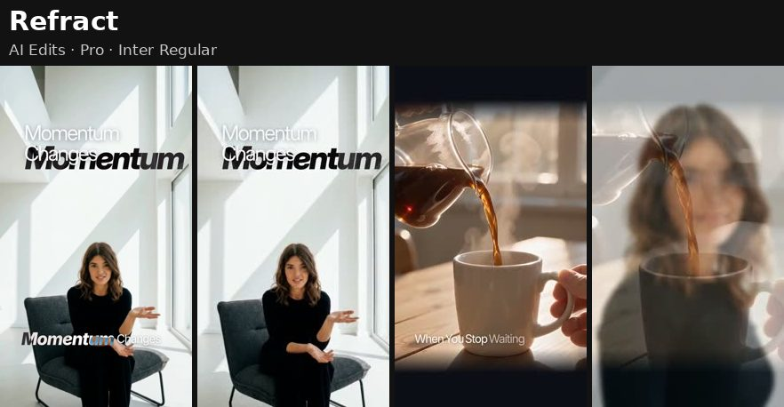

Words that build in, one huge chrome word, and zoom-blur cuts.  
Fonts: Inter Regular · Colours: `#FFFFFF` · Words/line: Up to 5 · Motion: Static emphasis · Plan: Pro · [page](https://makemoonshot.co/caption-templates/prism)

### Petal
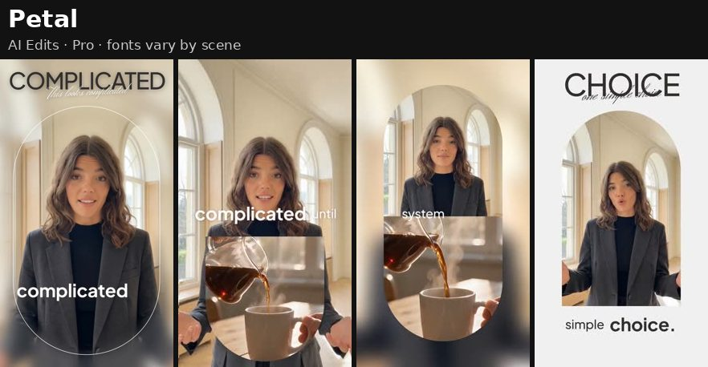

Soft editorial captions, arch frames, and caps titles crossed by script.  
Fonts: scene ke hisaab se · Colours: `#FFFFFF` · Words/line: Up to 4 · Motion: Static emphasis · Plan: Pro · [page](https://makemoonshot.co/caption-templates/bloom)

### Boldface
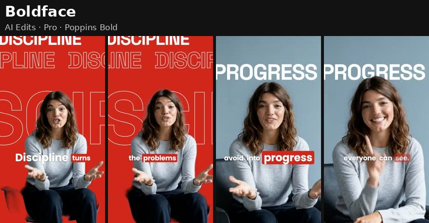

Bold captions with a boxed word, rounded video cards, and giant scrolling type.  
Fonts: Poppins Bold · Colours: `#FFFFFF` · Words/line: Up to 3 · Motion: A colour block sits behind the spoken word · Plan: Pro · [page](https://makemoonshot.co/caption-templates/stack)

### Gallery
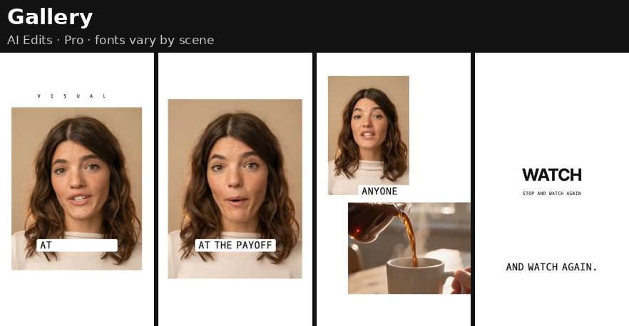

Swiss-minimal mono captions in a white label, and edge-aligned frames.  
Fonts: scene ke hisaab se · Colours: `#141414` · Words/line: Up to 3 · Motion: The spoken word sits in a box · Plan: Pro · [page](https://makemoonshot.co/caption-templates/align)

### Dossier
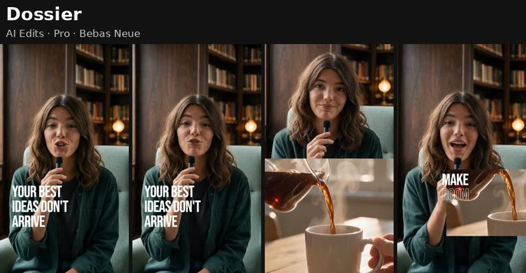

Documentary caps that fill as they are spoken, stacked hooks, and push cuts.  
Fonts: Bebas Neue · Colours: `#FFFFFF` · Words/line: Up to 3 · Motion: Upcoming words are outlines that fill as they are spoken · Plan: Pro · [page](https://makemoonshot.co/caption-templates/archive)

### Schematic
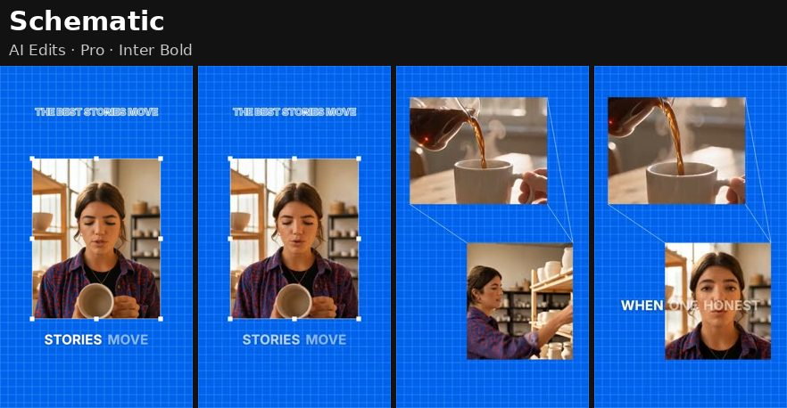

Bold caps with an underlined key word, graph paper, and selection boxes.  
Fonts: Inter Bold · Colours: `#FFFFFF` · Words/line: Up to 3 · Motion: Static emphasis · Plan: Pro · [page](https://makemoonshot.co/caption-templates/blueprint)

### Daydream
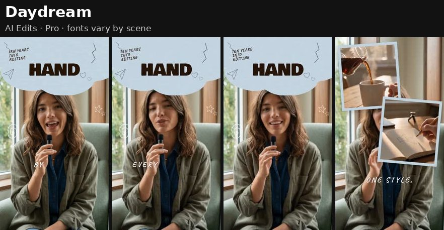

Hand-lettered caps, paper clouds, pencil doodles, and collage.  
Fonts: scene ke hisaab se · Colours: `#FFFFFF` · Words/line: Up to 3 · Motion: Static emphasis · Plan: Pro · [page](https://makemoonshot.co/caption-templates/zine)

### Notes
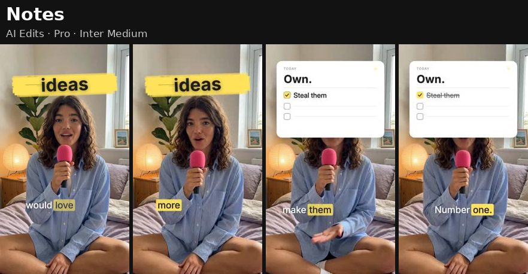

Highlighter captions, ticking note cards, screenshots and scribbles.  
Fonts: Inter Medium · Colours: `#FFFFFF #FFE15A` · Words/line: Up to 4 · Motion: A colour block sits behind the spoken word · Plan: Pro · [page](https://makemoonshot.co/caption-templates/notes)

### Darkroom
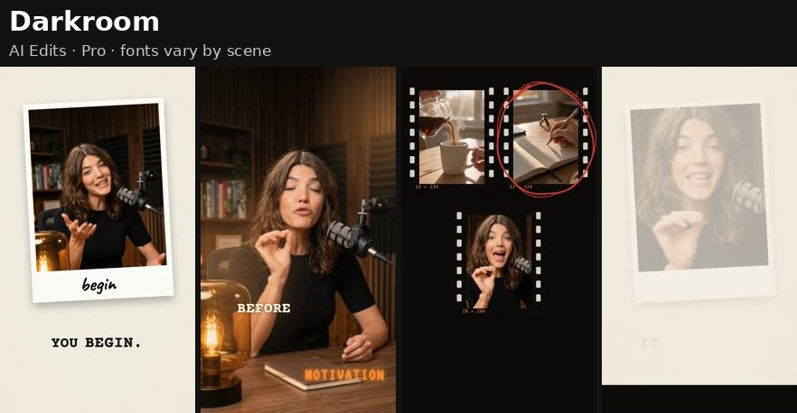

Typed warm captions, film frames, light leaks and a date stamp.  
Fonts: scene ke hisaab se · Colours: `#FFF3DC` · Words/line: Up to 4 · Motion: Static emphasis · Plan: Pro · [page](https://makemoonshot.co/caption-templates/darkroom)

### Riso
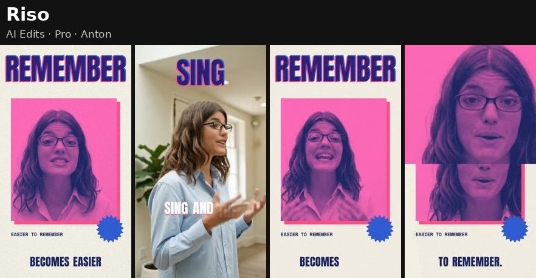

Two-ink duotone prints, misregistered titles, halftone and stickers.  
Fonts: Anton · Colours: `#FFFFFF` · Words/line: Up to 3 · Motion: Static emphasis · Plan: Pro · [page](https://makemoonshot.co/caption-templates/riso)

### B-Side
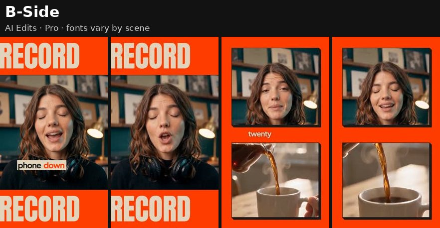

Cream label captions, poster bands, and long-shadow cards on a mustard sleeve.  
Fonts: scene ke hisaab se · Colours: `#1C1A18 #FF3C00` · Words/line: Up to 4 · Motion: The spoken word sits in a box · Plan: Pro · [page](https://makemoonshot.co/caption-templates/vinyl)

### Overclock
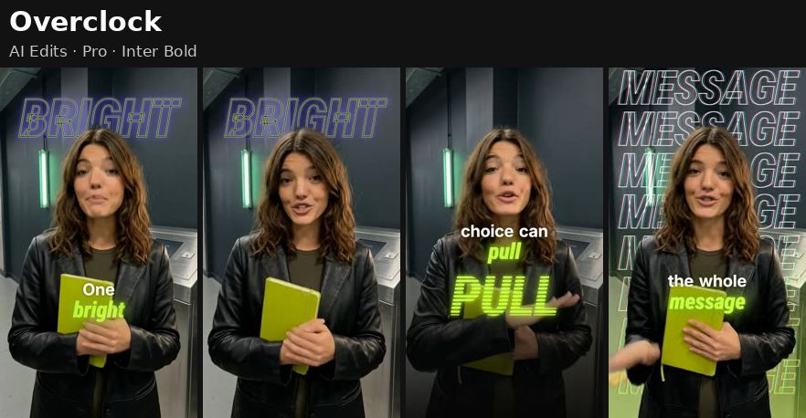

Lime italic keywords, outlined caps behind you, scanlines and a viewfinder.  
Fonts: Inter Bold · Colours: `#FFFFFF` · Words/line: Up to 4 · Motion: Static emphasis · Plan: Pro · [page](https://makemoonshot.co/caption-templates/overclock)

### Feed
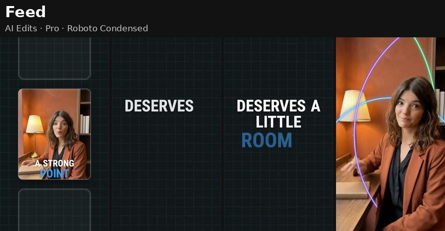

Condensed caps with a blue keyword, glass cards that scroll into place, bokeh and neon.  
Fonts: Roboto Condensed · Colours: `#FFFFFF` · Words/line: Up to 6 · Motion: Static emphasis · Plan: Pro · [page](https://makemoonshot.co/caption-templates/feed)

### Arcade
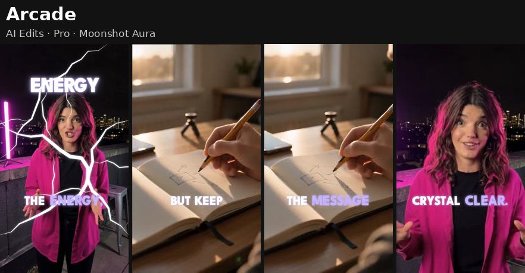

Glowing neon caps, lightning hooks, kaleidoscope cuts and bloomed B-roll.  
Fonts: Moonshot Aura · Colours: `#FFFFFF` · Words/line: Up to 2 · Motion: Static emphasis · Plan: Pro · [page](https://makemoonshot.co/caption-templates/arcade)

### Afterglow
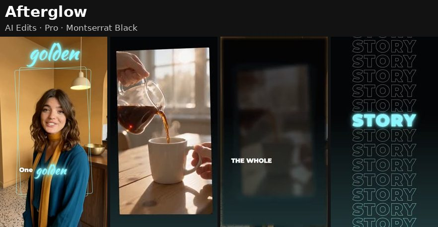

Wide caps with a glowing cyan script, tilted frames, cover flow and light beams.  
Fonts: Montserrat Black · Colours: `#FFFFFF` · Words/line: Up to 3 · Motion: Static emphasis · Plan: Pro · [page](https://makemoonshot.co/caption-templates/afterglow)

### Masthead
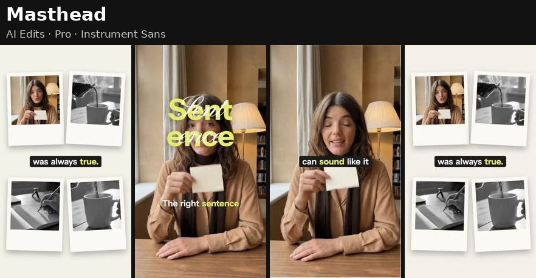

Editorial captions with a yellow keyword, cover lines, spreads and instant prints.  
Fonts: Instrument Sans · Colours: `#FFFFFF` · Words/line: Up to 4 · Motion: Static emphasis · Plan: Pro · [page](https://makemoonshot.co/caption-templates/masthead)

### Editorial Grain
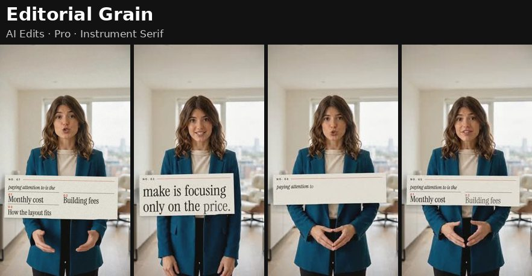

Serif magazine pages above your head, a red pen on contrasts, lists and numbers, and fine grain.  
Fonts: Instrument Serif · Colours: `#1A1A1A #C2412D` · Words/line: Up to 7 · Motion: Static emphasis · Plan: Pro · [page](https://makemoonshot.co/caption-templates/editorial-grain)

### Pop Bold
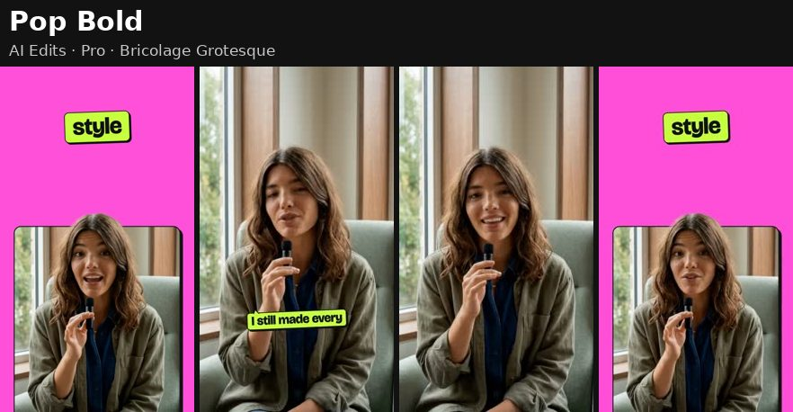

Chunky lime captions, neon blocks for every number, list and question, and a pop-up card on close-ups.  
Fonts: Bricolage Grotesque · Colours: `#111111` · Words/line: Up to 4 · Motion: Static emphasis · Plan: Pro · [page](https://makemoonshot.co/caption-templates/pop-bold)

### Cool Girl
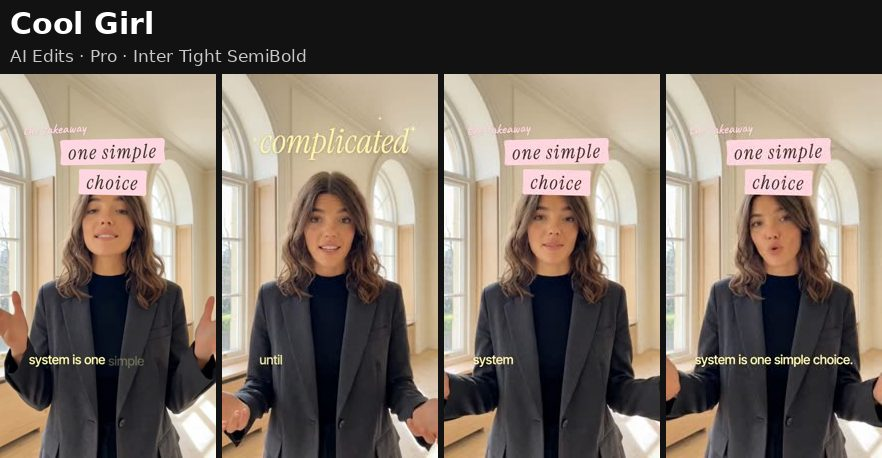

Soft butter captions, serif-italic titles for your numbers, lists and questions, a handwritten note.  
Fonts: Inter Tight SemiBold · Colours: `#FFF3A8 #FFD6E0` · Words/line: Up to 5 · Motion: Static emphasis · Plan: Pro · [page](https://makemoonshot.co/caption-templates/cool-girl)

### Bobblehead
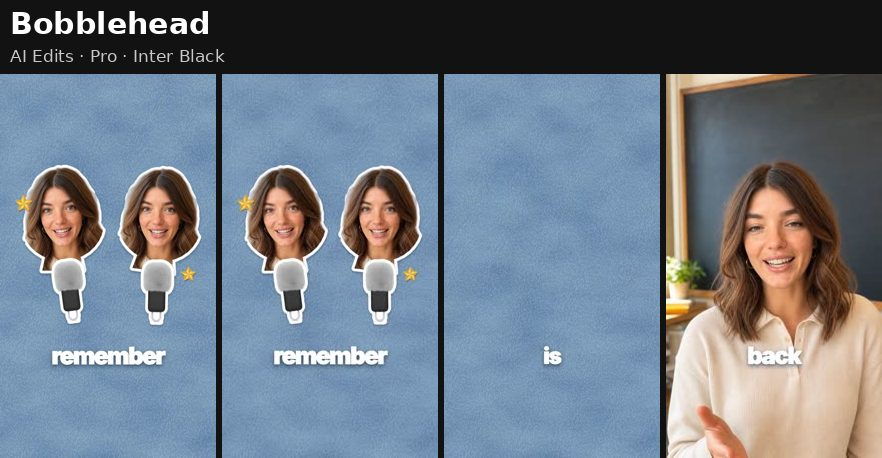

Your head as a bobbling sticker with a giant mic, sticker labels for every number and list, on denim.  
Fonts: Inter Black · Colours: `#FFFFFF` · Words/line: Up to 1 · Motion: Static emphasis · Plan: Pro · [page](https://makemoonshot.co/caption-templates/bobblehead)

### Slab
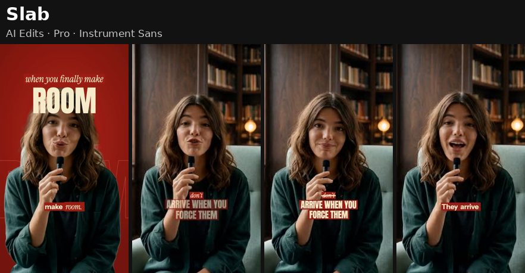

Brick tape captions, giant words that slip behind you, strikes, stamps and a counter.  
Fonts: Instrument Sans · Colours: `#F6EBC8` · Words/line: Up to 3 · Motion: The spoken word sits in a box · Plan: Pro · [page](https://makemoonshot.co/caption-templates/slab)

### Moments Glass
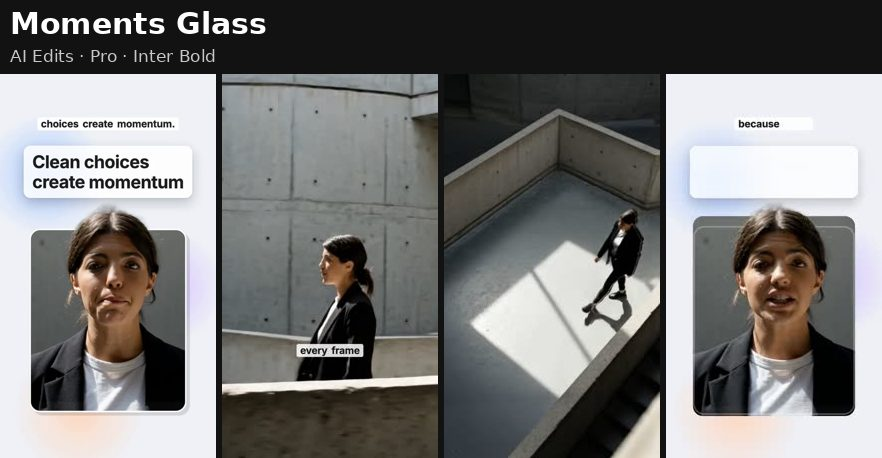

Frosted cards land on the word: counts that roll, lists that tick, contrasts that strike.  
Fonts: Inter Bold · Colours: `#1D1D1F` · Words/line: Up to 4 · Motion: The spoken word sits in a box · Plan: Pro · [page](https://makemoonshot.co/caption-templates/moments-glass)

### Moments Grain
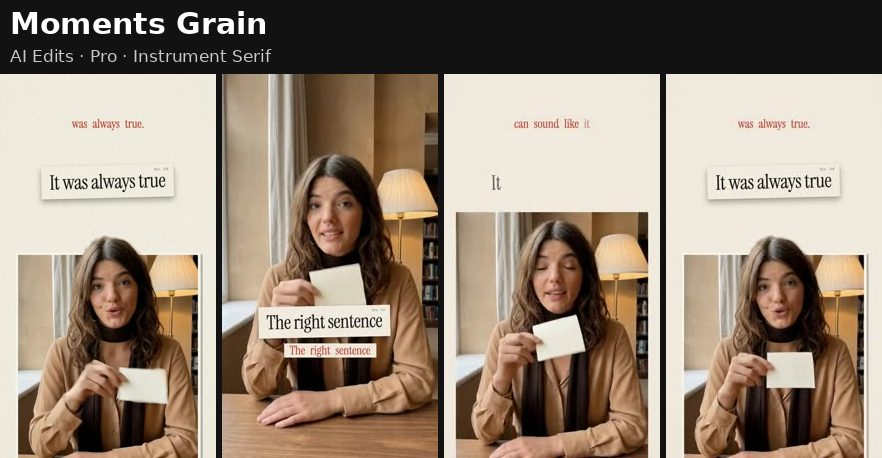

Paper-slip cards in a serif with red marks, landing on the word.  
Fonts: Instrument Serif · Colours: `#1A1A1A #C2412D` · Words/line: Up to 4 · Motion: The spoken word sits in a box · Plan: Pro · [page](https://makemoonshot.co/caption-templates/moments-grain)

### Moments Pop
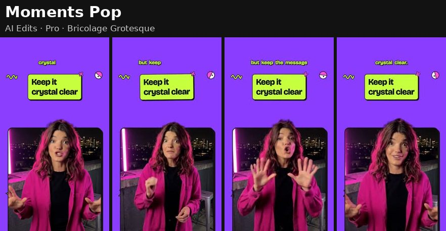

Bold lime and pink cards with ink outlines and stickers, landing on the word.  
Fonts: Bricolage Grotesque · Colours: `#FFFFFF #C6FF3D` · Words/line: Up to 4 · Motion: The spoken word flips to the highlight colour · Plan: Pro · [page](https://makemoonshot.co/caption-templates/moments-pop)

### Studio
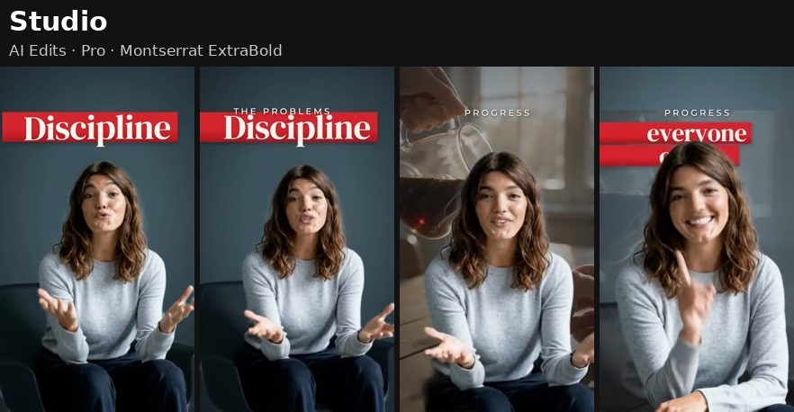

A dark room and a lit speaker: tracked caps over big serif words on a red bar, behind your head.  
Fonts: Montserrat ExtraBold · Colours: `#F7F4EE` · Words/line: Up to 3 · Motion: Static emphasis · Plan: Pro · [page](https://makemoonshot.co/caption-templates/studio)

### Podcast Cutout
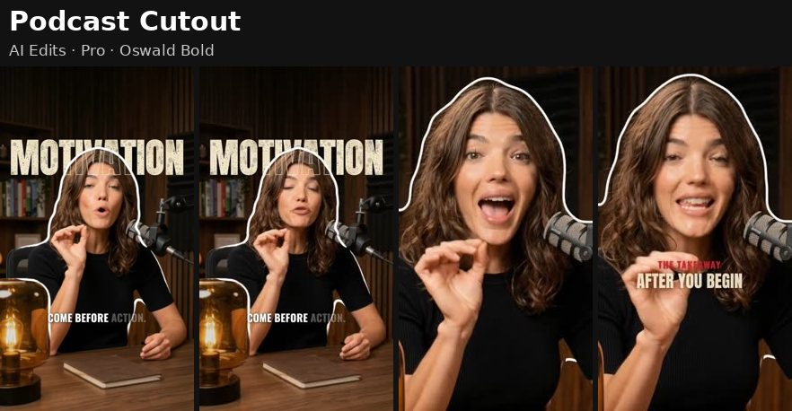

You cut out on black with a white ring, giant words behind your head and a red banner.  
Fonts: Oswald Bold · Colours: `#FFFFFF` · Words/line: Up to 3 · Motion: Static emphasis · Plan: Pro · [page](https://makemoonshot.co/caption-templates/podcast-cutout)

### Explainer
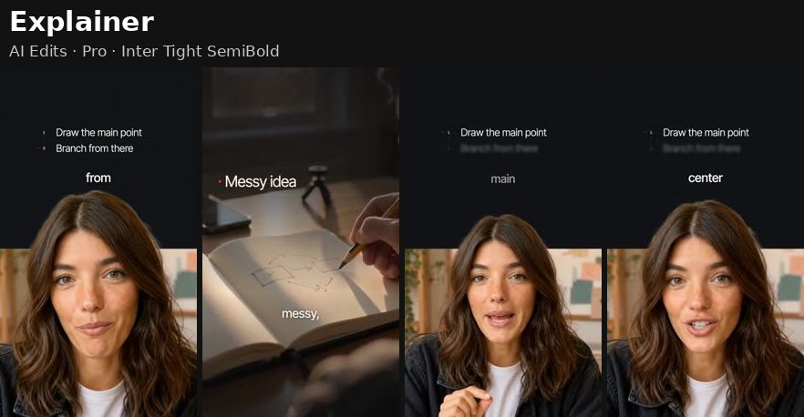

A teacher's board: you drop into the bottom half as the board opens above your head.  
Fonts: Inter Tight SemiBold · Colours: `#F2EFE8` · Words/line: Up to 1 · Motion: Static emphasis · Plan: Pro · [page](https://makemoonshot.co/caption-templates/explainer)

### Grid Notes
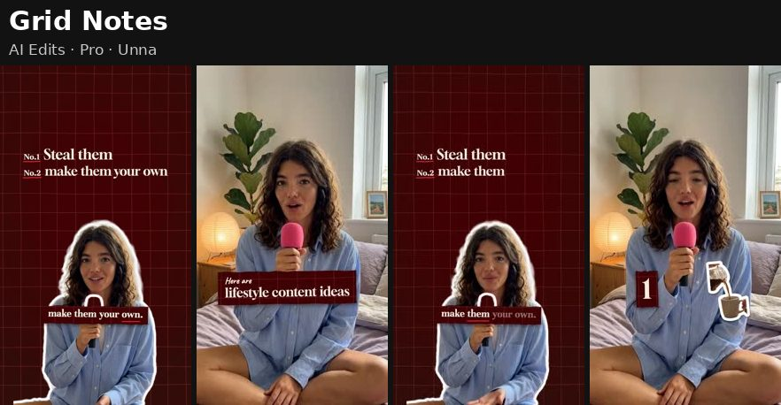

Serif notes on maroon grid paper, marks in your captions, and you as a sticker on the board.  
Fonts: Unna · Colours: `#F6EEDF` · Words/line: Up to 4 · Motion: Static emphasis · Plan: Pro · [page](https://makemoonshot.co/caption-templates/grid-notes)

### Moodboard
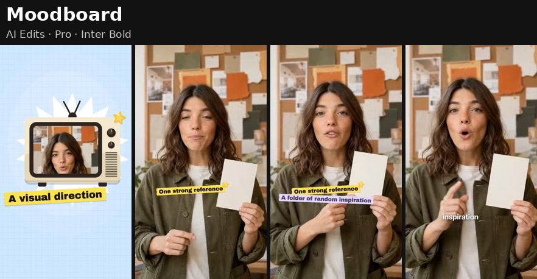

Tape, pinned tags and stickers land on the word; lists and definitions pinned on a pastel board.  
Fonts: Inter Bold · Colours: `#FFFFFF` · Words/line: Up to 3 · Motion: Static emphasis · Plan: Pro · [page](https://makemoonshot.co/caption-templates/moodboard)

### Keepsake

Soft print moments in serif and script, a letter in an envelope with a wax seal, an ornate frame.  
Fonts: Inter Tight ExtraBold · Colours: `#2A2321 #7A1E2C` · Words/line: Up to 4 · Motion: Static emphasis · Plan: Pro · [page](https://makemoonshot.co/caption-templates/keepsake)

### Cutout Board

Green graph paper, a traced cutout, and mixed paper-label captions around you.  
Fonts: Instrument Serif + BBH Bartle · Colours: `#FFFFFF #171816` · Words/line: Up to 4 · Motion: Static emphasis · Plan: Pro · [page](https://makemoonshot.co/caption-templates/cutout-board)

## 03-Real-Estate — Real Estate (4)

### Agent Story

Big yellow headlines, outlined amounts, glowing icons, and small spoken captions.  
Fonts: Poppins Bold · Colours: `#FFFFFF #F1F66F` · Words/line: Up to 16 · Motion: Static emphasis · Plan: Pro · [page](https://makemoonshot.co/caption-templates/agent-story)

### Number Story

Statistics count up beside sliding captions and your screenshot cards.  
Fonts: Poppins Bold + Roboto · Colours: `#FFFFFF #EC00B5` · Words/line: Up to 16 · Motion: Static emphasis · Plan: Pro · [page](https://makemoonshot.co/caption-templates/reach-counter)

### Gradient Estate

Outlined amounts, bold magenta words, and montages of your property photos.  
Fonts: Poppins Bold · Colours: `#FFFFFF #EC00B5` · Words/line: Up to 16 · Motion: Static emphasis · Plan: Pro · [page](https://makemoonshot.co/caption-templates/magenta-estate)

### Dimension Story

Rising, bouncing phrases, raised lettering, and colorful words layered around you.  
Fonts: Poppins Bold · Colours: `#FFFFFF #EC00B5` · Words/line: Up to 16 · Motion: Static emphasis · Plan: Pro · [page](https://makemoonshot.co/caption-templates/dimension-story)

## 04-Spatial — Spatial (3)

### Spatial Red

Small warm words and huge red uppercase heroes posted around your shot, tracked to the camera.  
Fonts: Inter Medium + Anton · Colours: `#FFF8EE #B90000` · Words/line: Up to 3 · Motion: Static emphasis · Plan: Pro · [page](https://makemoonshot.co/caption-templates/spatial-red)

### Spatial Yellow

Heavy white lines build around you while glowing yellow words slide in; plain words come one at a time.  
Fonts: Inter Black · Colours: `#FFFFFF #FFE000` · Words/line: Up to 3 · Motion: Static emphasis · Plan: Pro · [page](https://makemoonshot.co/caption-templates/spatial-yellow)

### Spatial White

Words arc over your head and across your chest in 3D; the red one lands biggest.  
Fonts: Inter Bold · Colours: `#F6EDE2 #D00A07` · Words/line: Up to 3 · Motion: Static emphasis · Plan: Pro · [page](https://makemoonshot.co/caption-templates/spatial-white)

## 05-Playful — Playful (6)

### Cutout

Large centered phrases build across two rows with an inverted hero word.  
Fonts: Archivo Black · Colours: `#FFFFFF` · Words/line: Up to 4 · Motion: Static emphasis · Plan: Pro · [page](https://makemoonshot.co/caption-templates/ca-cutout)

### Blush Lab

Tight blush captions type across two rows, then land on one butter word.  
Fonts: Inter Bold + Inter Black · Colours: `#F7B8D2 #FFFFFF` · Words/line: Up to 8 · Motion: Static emphasis · Plan: Creator · [page](https://makemoonshot.co/caption-templates/blush-lab)

### Butter

Tiny white asides up top; big butter-yellow words lock behind you.  
Fonts: Inter Bold + Poppins Bold · Colours: `#FFFFFF #F6FBC5` · Words/line: Up to 3 · Motion: Static emphasis · Plan: Pro · [page](https://makemoonshot.co/caption-templates/play-butter)

### Pop Off

One font, two colors: small white asides, big chartreuse hits around you.  
Fonts: Inter Black · Colours: `#FFFFFF #E3FC3E` · Words/line: Up to 4 · Motion: Static emphasis · Plan: Pro · [page](https://makemoonshot.co/caption-templates/play-moxie)

### Ribbon

A mix: words curve over you, sit in front, or lock behind you.  
Fonts: Montserrat Bold + Abril Fatface · Colours: `#FFFFFF #FFE451` · Words/line: Up to 4 · Motion: Static emphasis · Plan: Pro · [page](https://makemoonshot.co/caption-templates/play-curve)

### Cursive

Butter script + rounded heroes around you; tiny white ticker up top.  
Fonts: Montserrat ExtraBold · Colours: `#FFFFFF #F4F1BE` · Words/line: Up to 3 · Motion: Static emphasis · Plan: Pro · [page](https://makemoonshot.co/caption-templates/play-cursive)

## 06-Multiline — Multiline (10)

### Focusline

Editorial caption lockups that respond to each spoken idea.  
Fonts: Inter Regular + Inter Black · Colours: `#F3F0EA #9BCDD0` · Words/line: Up to 7 · Motion: Static emphasis · Plan: Pro · [page](https://makemoonshot.co/caption-templates/ca-focusline)

### Fireline

Handwritten white lines build into a rising yellow title.  
Fonts: Just Me Again Down Here + BBH Bartle · Colours: `#FFFFFF #FFC200` · Words/line: Up to 2 · Motion: The spoken word flips to the highlight colour · Plan: Creator · [page](https://makemoonshot.co/caption-templates/ca-fireline)

### Moonbeam

A glowing hero spans two of three fixed caption lanes.  
Fonts: Inter Bold + Archivo Black · Colours: `#67E8F9` · Words/line: Up to 4 · Motion: Static emphasis · Plan: Creator · [page](https://makemoonshot.co/caption-templates/ml-halo)

### Supernova

Small white context with one oversized editorial hit.  
Fonts: Instrument Sans + Archivo Black · Colours: `#FFFFFF` · Words/line: Up to 6 · Motion: Static emphasis · Plan: Creator · [page](https://makemoonshot.co/caption-templates/ml-illusion)

### Gold Centre

Compact context with a hard gold all-caps centre word.  
Fonts: Montserrat Bold + Black Han Sans · Colours: `#FFD84D` · Words/line: Up to 6 · Motion: Static emphasis · Plan: Creator · [page](https://makemoonshot.co/caption-templates/ml-masala)

### Blue Muse

Playfair italic, compact support type, and one ice-blue uppercase key.  
Fonts: Playfair Display + Moonshot Aura · Colours: `#FFFFFF #7FD3FF` · Words/line: Up to 4 · Motion: Static emphasis · Plan: Creator · [page](https://makemoonshot.co/caption-templates/ml-aura)

### Diagonal

Inter Black roles in a diagonal white-and-yellow editorial lockup.  
Fonts: Inter Black · Colours: `#FFFFFF #F5D300` · Words/line: Up to 4 · Motion: Static emphasis · Plan: Creator · [page](https://makemoonshot.co/caption-templates/ml-swiss)

### Red Shift

A tall red hero sits between two restrained white rows.  
Fonts: Instrument Sans + Anton · Colours: `#F43F4A` · Words/line: Up to 6 · Motion: Static emphasis · Plan: Creator · [page](https://makemoonshot.co/caption-templates/ml-redline)

### Margin Note

Loose handwritten rows with one warm marker-like word.  
Fonts: Caveat Bold + Caveat Brush · Colours: `#F8EDE2 #FFE08A` · Words/line: Up to 6 · Motion: Static emphasis · Plan: Creator · [page](https://makemoonshot.co/caption-templates/ml-scribble)

### Headliner

Red condensed type against luminous white script.  
Fonts: Dancing Script + Anton · Colours: `#FFFFFF #D53E3E` · Words/line: Up to 4 · Motion: Static emphasis · Plan: Creator · [page](https://makemoonshot.co/caption-templates/ml-blockbuster)

## 07-Dynamic — Dynamic (6)

### Inception

Impact words invert the footage and fill the frame.  
Fonts: Anton · Colours: `#D2D2D2 #FFFFFF` · Words/line: Up to 1 · Motion: Static emphasis · Plan: Pro · [page](https://makemoonshot.co/caption-templates/dyn-stretch)

### Linen

Letters type on behind a translucent cursor.  
Fonts: Bricolage Grotesque · Colours: `#FFFFFF` · Words/line: Up to 5 · Motion: Static emphasis · Plan: Creator · [page](https://makemoonshot.co/caption-templates/dyn-linen)

### Quill

A script opener flickers over typed supporting words.  
Fonts: Inter Regular + Ballet · Colours: `#FFFFFF` · Words/line: Up to 4 · Motion: Static emphasis · Plan: Creator · [page](https://makemoonshot.co/caption-templates/dyn-quill)

### Storyline

Serif key words slide between clean story beats.  
Fonts: Inter Regular + Playfair Display · Colours: `#F5F0D0` · Words/line: Up to 3 · Motion: Static emphasis · Plan: Creator · [page](https://makemoonshot.co/caption-templates/dyn-storyline)

### Glide

A bright script word glides through quiet context.  
Fonts: Inter Regular + Pinyon Script · Colours: `#FFFFFF #DFFF35` · Words/line: Up to 3 · Motion: Static emphasis · Plan: Creator · [page](https://makemoonshot.co/caption-templates/dyn-glide)

### Wiggle

Hand-painted words trace an organic eight-step path.  
Fonts: Lacquer · Colours: `#FFFFFF #FFD700` · Words/line: Up to 3 · Motion: The spoken word flips to the highlight colour · Plan: Creator · [page](https://makemoonshot.co/caption-templates/dyn-wiggle)

## 08-Editorial — Editorial (7)

### Aura

Serif-italic aside over a huge ice-blue word behind you.  
Fonts: Instrument Serif + Archivo Black · Colours: `#FFFFFF #7FD3FF` · Words/line: Up to 4 · Motion: The spoken word flips to the highlight colour · Plan: Pro · [page](https://makemoonshot.co/caption-templates/aura)

### Delhi

Clean sans, then the key word in glowing serif italic.  
Fonts: Instrument Sans + Instrument Serif · Colours: `#FFFFFF` · Words/line: Up to 4 · Motion: Static emphasis · Plan: Creator · [page](https://makemoonshot.co/caption-templates/delhi)

### Soft Script

Bold white sans with key words in Playfair italic.  
Fonts: Open Sans + Playfair Display · Colours: `#FFFFFF` · Words/line: Up to 5 · Motion: Static emphasis · Plan: Creator · [page](https://makemoonshot.co/caption-templates/soft-script)

### Swiss

White lowercase over hard yellow caps. Pure grid.  
Fonts: Inter Black · Colours: `#FFFFFF #F5D300` · Words/line: Up to 4 · Motion: Static emphasis · Plan: Creator · [page](https://makemoonshot.co/caption-templates/swiss)

### Masala

A whisper of context, then one huge gold word behind you.  
Fonts: Montserrat Bold + Archivo Black · Colours: `#FFFFFF #FFD700` · Words/line: Up to 4 · Motion: The spoken word flips to the highlight colour · Plan: Pro · [page](https://makemoonshot.co/caption-templates/masala)

### Chrome

Liquid-metal caps locked behind the speaker.  
Fonts: Black Han Sans · Colours: `#FFFFFF` · Words/line: Up to 3 · Motion: Static emphasis · Plan: Pro · [page](https://makemoonshot.co/caption-templates/chrome)

### Serif Quote

Editorial serif, sentence case, italic amber emphasis.  
Fonts: DM Serif Display · Colours: `#FFFFFF #FFD9A8` · Words/line: Up to 5 · Motion: Static emphasis · Plan: Creator · [page](https://makemoonshot.co/caption-templates/serif-quote)

## 09-Neon-and-FX — Neon & FX (1)

### Liquid Glass

A translucent frosted-glass pill with a soft luminous rim.  
Fonts: Instrument Sans · Colours: `#FFFFFF` · Words/line: Up to 5 · Motion: The spoken word sits in a box · Plan: Creator · [page](https://makemoonshot.co/caption-templates/liquid-glass)

## 10-Creators — Creators (2)

### Beast Mode

Comic caps with a fat outline; keywords glow green.  
Fonts: Luckiest Guy · Colours: `#FFFFFF #3DFF7C` · Words/line: Up to 2 · Motion: Words glow like neon · Plan: Creator · [page](https://makemoonshot.co/caption-templates/beast-mode)

### Karaoke

The colour wipes across each word as it's said.  
Fonts: Black Han Sans · Colours: `#FFFFFF #FFE500` · Words/line: Up to 4 · Motion: The highlight colour wipes across each word as it is spoken · Plan: Creator · [page](https://makemoonshot.co/caption-templates/karaoke-bar)

## 11-Desi — Desi (2)

### Desi Bold

Hindi and roman in one face; hero word behind you.  
Fonts: Baloo 2 ExtraBold · Colours: `#FFFFFF #FFE14F` · Words/line: Up to 4 · Motion: The spoken word flips to the highlight colour · Plan: Pro · [page](https://makemoonshot.co/caption-templates/desi-bold)

### Tabahi

Full hype: comic caps over a rounded Hinglish line.  
Fonts: Baloo 2 ExtraBold + Anton · Colours: `#FFFFFF` · Words/line: Up to 4 · Motion: Static emphasis · Plan: Creator · [page](https://makemoonshot.co/caption-templates/tabahi)

## 12-Social — Social (2)

### Floodlight

Yellow box, black ink on the key word.  
Fonts: Montserrat ExtraBold · Colours: `#FFFFFF #FFE500` · Words/line: Up to 3 · Motion: A colour block sits behind the spoken word · Plan: Creator · [page](https://makemoonshot.co/caption-templates/social-yellow)

### Pink Neon

White caps with a pink neon glow.  
Fonts: Montserrat ExtraBold · Colours: `#FFFFFF` · Words/line: Up to 3 · Motion: Static emphasis · Plan: Creator · [page](https://makemoonshot.co/caption-templates/social-glow)

## 13-Retro — Retro (4)

### Flashbulb

Bold yellow with a black outline.  
Fonts: Montserrat ExtraBold · Colours: `#FFE500` · Words/line: Up to 3 · Motion: Static emphasis · Plan: Creator · [page](https://makemoonshot.co/caption-templates/retro-pop)

### Filmstrip

Black box, yellow active word.  
Fonts: Montserrat ExtraBold · Colours: `#FFFFFF #FFE500` · Words/line: Up to 5 · Motion: The spoken word sits in a box · Plan: Creator · [page](https://makemoonshot.co/caption-templates/retro-yellow-word)

### Dolly

Small setup, big keyword slides forward.  
Fonts: Montserrat ExtraBold · Colours: `#FFFFFF #F6C65B` · Words/line: Up to 2 · Motion: Words spring in as they are spoken · Plan: Creator · [page](https://makemoonshot.co/caption-templates/spring)

### Searchlight

A light band scans across the words.  
Fonts: Montserrat ExtraBold · Colours: `#FFFFFF #D9FF2F` · Words/line: Up to 4 · Motion: A light sweep follows the voice · Plan: Creator · [page](https://makemoonshot.co/caption-templates/sweep)
